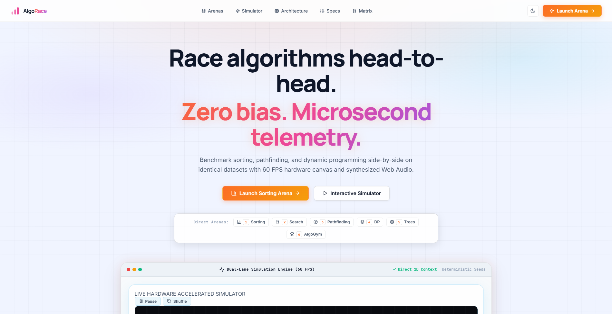
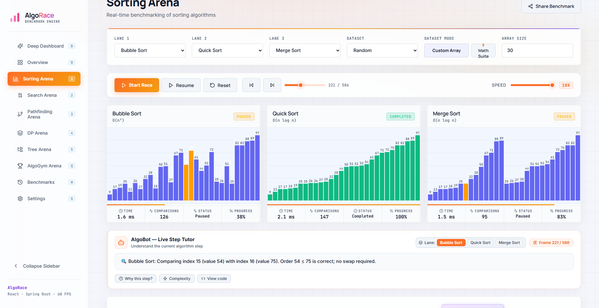
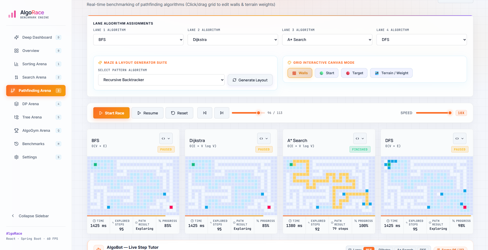
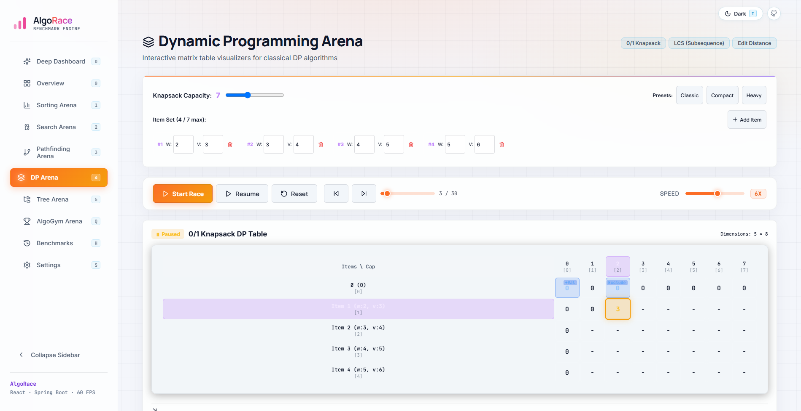
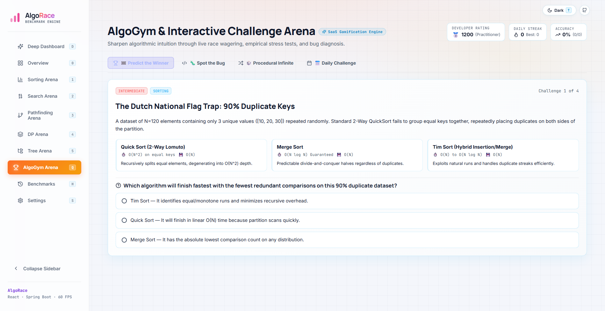
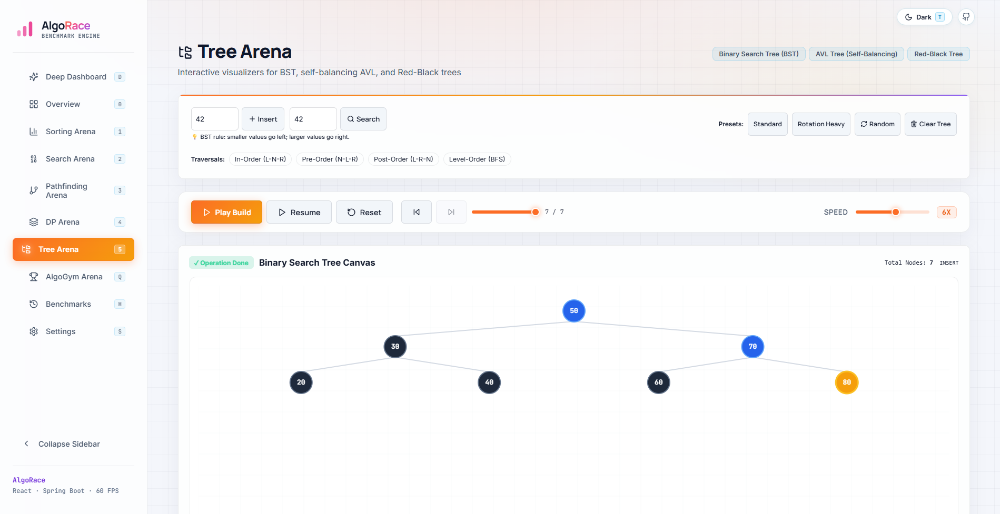

# AlgoRace — Algorithm Benchmark & Visualization Engine

<div align="center">


### **Visualize • Compare • Benchmark • Race**

*A high-performance, full-stack interactive engineering platform designed to benchmark, debug, and race computer science algorithms in real-time.*

[**🌐 Live Application**](https://algorithm-race-visualizer.vercel.app) • [**📖 API Documentation**](https://algorithmracevisualizer.onrender.com/swagger-ui.html) • [**⚡ Quickstart Guide**](#-local-development--setup) • [**🎮 AlgoGym Arena**](#4--algogym--interactive-challenge-arena)

</div>

---

## 📸 Visual Showcase & Arenas

<div align="center">

### **Live Race Animation Demo**


</div>

| **Landing Portal & Arena Launcher** | **Multi-Lane Sorting Arena** |
|:---:|:---:|
|  |  |

| **2D Grid Pathfinding Arena** | **Dynamic Programming Arena** |
|:---:|:---:|
|  |  |

| **AlgoGym Challenge Arena** | **Tree Data Structures Arena** |
|:---:|:---:|
|  |  |

---

## ⚡ What Makes AlgoRace Different?

Unlike static single-algorithm visualizers, **AlgoRace** is built around a concurrent **Head-to-Head Deterministic Race Engine**. Multiple algorithms (e.g., *Quick Sort vs. Merge Sort vs. Tim Sort*, or *Dijkstra vs. A\* Search vs. Bidirectional BFS*) execute simultaneously on **identical dataset seeds and identical maze topographies**.

### 🌟 Key Enterprise Highlights:
- **🎨 HTML5 Canvas 60 FPS Hardware Renderer**: High-density datasets ($N \ge 10,000$) animate at steady 60 FPS using hardware-accelerated 2D canvas contexts without DOM frame drops.
- **🧵 Hybrid Dual-Execution Architecture**: Instant client-side simulations offloaded to background **Web Workers** (`simulationWorker.ts`) paired with a robust **Spring Boot Java 21** server for deterministic server-side execution.
- **💻 Synchronized Multi-Language Code Tracing**: Real-time line-by-line code execution highlighter supporting **TypeScript, Java, Python, and C++** with step operation tags (`COMPARING`, `SWAPPING`, `VISITING`, `BOUNDING`).
- **🏆 AlgoGym & CS Interview Diagnostic Arena**: Gamified algorithmic challenges including *Predict the Winner* on adversarial distributions, *Spot the Bug* (Joshua Bloch's binary search overflow, 0/1 Knapsack loop direction), and Elo developer rankings (**Apprentice $\to$ Practitioner $\to$ System Architect $\to$ Grandmaster**).
- **🧩 Dynamic Programming Matrix Visualizer**: Step-by-step recurrence tables with active state formula evaluation for **0/1 Knapsack, Longest Common Subsequence (LCS), and Edit Distance (Levenshtein)**.
- **🌲 Self-Balancing Tree Engine**: Interactive Binary Search Tree (BST), AVL self-balancing rotations, and animated In-order, Pre-order, Post-order, and Level-order (BFS) traversals.
- **🗺️ Procedural Maze Generator Suite**: 9 algorithmic maze generators (*Recursive Backtracker, Prim's Algorithm, Spiral, Rooms, Cellular Automata, Weighted Terrain Map*).
- **🌐 Embeddable Iframe Widget & Zero-Chrome Mode**: Embed responsive, interactive algorithm visualizers into external technical blogs (Dev.to, Medium, Hashnode), docs, and portfolios via `?embed=true`.
- **🔗 Deep-Link URL State & Permalinks**: Exact custom arrays, algorithm selections, speed, and size are serialized into URL query parameters for 1-click reproducible sharing.
- **👁️ Accessibility & Theming Engine**: Bespoke dark & light quantum aesthetics with dedicated high-contrast accessibility palettes for **Deuteranopia** and **Protanopia**.
- **⏱️ Step-by-Step Debugger & Timeline Scrubber**: Seek to any frame with instant timeline scrubbing, frame stepping, and variable speed scaling ($1\times - 10\times$).
- **📊 Telemetry & Benchmark Data Exporter**: Export sanitized CSV performance benchmarks and high-resolution 2x Retina PNG snapshots.
- **🔊 Web Audio API Synthesizer**: Polyphonic pitch-mapped acoustic feedback providing real-time audio chimes for swaps, comparisons, and tree/graph traversals.

---

## 💡 Why I Built AlgoRace

> *"I built AlgoRace because Big-O notation and static pseudocode never fully captured how algorithms actually behave for me. $O(n \log n)$ tells you the growth rate, but it doesn't show you why Quick Sort pulls ahead of Bubble Sort on the same dataset, or how Dijkstra's algorithm actually explores a graph step by step.*
>
> *AlgoRace turns that into something you can watch and interact with. Sorting algorithms race side by side on identical dataset seeds, search algorithms visualize their space elimination as it happens, and pathfinding runs on 2D grids you can edit and re-run in real time.*
>
> *It's a full-stack project: a Spring Boot Java backend generates deterministic simulation steps, a React 18 + TypeScript frontend renders them on HTML5 Canvas, and a Web Audio synthesizer adds sound feedback for comparisons and swaps."*
>
> — **Muhammad Sanan Sarwar** (Creator & Lead Engineer)

---

## 🎯 Supported Algorithms & Interactive Arenas

### 1. 📊 Sorting Arena (12 Algorithms)
Compare comparison and non-comparison sorting algorithms side-by-side on identical array distributions:
- **Quick Sort** — $O(n \log n)$ average, $O(n^2)$ worst, $O(\log n)$ space.
- **Merge Sort** — $O(n \log n)$ guaranteed, $O(n)$ space.
- **Heap Sort** — $O(n \log n)$ in-place heapification, $O(1)$ space.
- **Tim Sort** — $O(n)$ best, $O(n \log n)$ worst (Production hybrid sort used in Python/Java).
- **Insertion Sort** — $O(n)$ best, $O(n^2)$ average/worst, $O(1)$ space.
- **Selection Sort** — $O(n^2)$ best/average/worst, $O(1)$ space.
- **Bubble Sort** — $O(n)$ best, $O(n^2)$ average/worst, $O(1)$ space.
- **Comb Sort** — $O(n \log n)$ best, $O(n^2 / 2^p)$ average, $O(1)$ space.
- **Shell Sort** — $O(n \log n)$ best, $O(n^{1.3})$ average, $O(1)$ space.
- **Cocktail Shaker Sort** — Bidirectional bubble sort with $O(n)$ best, $O(1)$ space.
- **Radix Sort & Counting Sort** — Non-comparison linear integer bucket distribution sorting.
- **Math Suite Distributions**: Random, Nearly Sorted, Reversed, Few Unique, Gaussian Normal, Organ-Pipe, Sawtooth, and Staircase.

---

### 2. 🗺️ 2D Grid Pathfinding Arena (6 Algorithms + 9 Mazes)
Visualize graph traversal, heuristics, and optimal shortest-path discovery on interactive editable grids:
- **A\* Search** — Heuristic-guided Manhattan/Euclidean optimal exploration.
- **Dijkstra's Algorithm** — Guaranteed shortest-path exploration on weighted graphs.
- **Breadth-First Search (BFS)** — Level-order queue shortest-path traversal on unweighted grids.
- **Bidirectional BFS** — Dual-frontier simultaneous search meeting in the middle.
- **Greedy Best-First Search** — Fast heuristic-driven exploration toward the target.
- **Depth-First Search (DFS)** — Stack-based exploratory path traversal.
- **Interactive Canvas Tools**: Paint Walls, Start Node, Target Node, and Weighted Terrain (Mud $3\times$, Water $5\times$).
- **Procedural Maze Generators**: Recursive Backtracker, Prim's Algorithm, Spiral, Rooms, Binary Tree, Recursive Division, Cellular Automata, and Weighted Terrain Map.

---

### 3. 🧩 Dynamic Programming Arena
Deconstruct complex subproblem memoization with interactive matrix table step visualizers:
- **0/1 Knapsack Problem** — Interactive DP matrix tracking optimal value combinations against weight capacity ($W$) with live recurrence formula `dp[i][w] = max(...)` and cell dependency arrows.
- **Longest Common Subsequence (LCS)** — 2D string alignment grid highlighting matching characters and backtrack reconstruction paths.
- **Edit Distance (Levenshtein)** — Minimal character insert, delete, and replace operation recurrence grid.

---

### 4. 🌲 Tree Data Structures Arena
Inspect hierarchical data structures and self-balancing tree rotations:
- **Binary Search Tree (BST)** — Real-time binary tree insertion, search paths, and node deletions.
- **AVL Tree (Self-Balancing)** — Automatic balance factor calculation with animated Left-Left, Right-Right, Left-Right, and Right-Left rotations.
- **Red-Black Tree** — Node recoloring and structural balance verification.
- **Traversals**: Animated In-order ($L-N-R$), Pre-order ($N-L-R$), Post-order ($L-R-N$), and Level-order (BFS) search frontiers.

---

### 5. 🔍 Search Arena (5 Algorithms)
Benchmark search heuristics across sorted array spaces:
- **Linear Search** — $O(1)$ best, $O(n)$ worst.
- **Binary Search** — $O(1)$ best, $O(\log n)$ worst logarithmic elimination.
- **Jump Search** — $O(\sqrt{n})$ block jumping.
- **Exponential Search** — $O(\log n)$ unbounded range doubling.
- **Interpolation Search** — $O(\log \log n)$ uniformly distributed probe calculation.

---

### 6. 🏆 AlgoGym & Interactive Challenge Arena
Sharpen algorithmic intuition through live race prediction, empirical stress-testing, and bug diagnosis:
- **🏁 Predict the Winner**: Wager on algorithmic performance across adversarial datasets (*Dutch National Flag 90% duplicates, 98% inversions, reversed permutations*) and watch the live race prove or disprove the theory.
- **🐛 Spot the Bug**: Diagnostic code inspection for classic engineering traps (integer overflow in binary search midpoints, knapsack 1D loop direction).
- **🎲 Procedural Infinite Showdowns**: Infinite mathematical distribution generator.
- **🏅 Persistent Elo Ranking & Streaks**: Developer tier ratings (**Apprentice**, **Practitioner**, **System Architect**, **Grandmaster**) with streak multipliers.

---

### 7. 📈 Deep Dashboard & Telemetry Analytics
- Dynamic empirical scaling curves comparing theoretical vs. measured execution cycles.
- Microsecond timing metrics, comparison/swap ratios, and leaderboard rankings.
- 1-click **Export Benchmark CSV** and high-resolution **Export Snapshot PNG (2x Retina)**.

---

## ⌨️ Global Keyboard Shortcuts

| Shortcut | Destination / Action | Shortcut | Destination / Action |
|:---:|:---|:---:|:---|
| <kbd>0</kbd> / <kbd>Esc</kbd> | Overview / Landing Portal | <kbd>5</kbd> | Tree Data Structures Arena |
| <kbd>1</kbd> | Sorting Arena | <kbd>6</kbd> / <kbd>Q</kbd> | AlgoGym & Challenge Arena |
| <kbd>2</kbd> | Search Arena | <kbd>S</kbd> | Settings & Customization |
| <kbd>3</kbd> | Pathfinding Arena | <kbd>H</kbd> | Run History & Benchmarks |
| <kbd>4</kbd> | Dynamic Programming Arena | <kbd>T</kbd> | Toggle Theme (Dark / Light) |

---

## 🌐 Embedding AlgoRace in Your Website / Blog

Embed responsive interactive visualizers inside any Markdown post, Notion document, Medium article, or portfolio:

```html
<iframe 
  src="https://algorithm-race-visualizer.vercel.app/?page=sorting&embed=true#sorting" 
  width="100%" 
  height="540" 
  frameborder="0" 
  loading="lazy" 
  style="border-radius: 12px; border: 1px solid rgba(255,255,255,0.12); box-shadow: 0 12px 32px rgba(0,0,0,0.5);">
</iframe>
```

---

## 🛠️ Technology Stack & Architecture

```
   ┌────────────────────────────────────────────────────────────────────────┐
   │                            CLIENT LAYER                                │
   │  React 18  •  TypeScript  •  Vite  •  HTML5 Canvas (60 FPS)           │
   │  Web Audio Synthesizer  •  Web Workers  •  CSS Design Tokens           │
   └───────────────────────────────────┬────────────────────────────────────┘
                                       │ REST / SSE Stream / Fallback
   ┌───────────────────────────────────┴────────────────────────────────────┐
   │                           BACKEND ENGINE                               │
   │  Java 21  •  Spring Boot 3.4  •  Maven  •  Spotless  •  Swagger/OpenAPI│
   └───────────────────────────────────┬────────────────────────────────────┘
                                       │ Cloud Deployment
   ┌───────────────────────────────────┴────────────────────────────────────┐
   │                       EDGE & CLOUD INFRASTRUCTURE                      │
   │  Frontend: Vercel Global Edge CDN   │   Backend: Render Cloud Service  │
   └────────────────────────────────────────────────────────────────────────┘
```

---

## 🔧 Local Development & Setup

### Prerequisites
- **Node.js** (v18+ or v20+)
- **Java JDK** (v21+)
- **Apache Maven** (v3.9+)

### 1. Clone Repository
```bash
git clone https://github.com/Sanan507/AlgorithmRaceVisualizer.git
cd AlgorithmRaceVisualizer
```

### 2. Run Backend (Spring Boot 3.4)
```bash
cd backend
mvn spring-boot:run
```
*Backend server runs on `http://localhost:8080`.*  
*Swagger API Documentation is served at `http://localhost:8080/swagger-ui.html`.*

### 3. Run Frontend (React 18 + Vite)
```bash
cd frontend
npm install
npm run dev
```
*Frontend application runs on `http://localhost:5173`.*

---

## 🧪 Testing & Code Quality

```bash
# Frontend Typecheck & Production Build
cd frontend
npm run build
npm test

# Backend Spotless Format & JUnit Tests
cd backend
mvn spotless:apply
mvn test
```

---

## 👤 Author & Contact

- **Author**: **Muhammad Sanan Sarwar**
- **Email**: [sanansarwar507@gmail.com](mailto:sanansarwar507@gmail.com)
- **LinkedIn**: [sanan-sarwar](https://www.linkedin.com/in/sanan-sarwar)
- **GitHub**: [Sanan507](https://github.com/Sanan507)
- **Live App**: [algorithm-race-visualizer.vercel.app](https://algorithm-race-visualizer.vercel.app)
- **License**: MIT License (Permissive Open Source)
